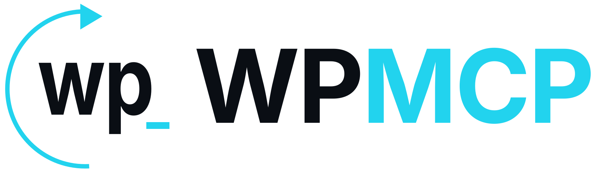

<picture>
  <source media="(prefers-color-scheme: dark)" srcset="https://raw.githubusercontent.com/wpmcp/.github/main/profile/assets/wpmcp-logo-horizontal-dark-bg.svg">
  
</picture>

# WPMCP: WordPress MCP with undo

**Connect Claude, ChatGPT or Cursor to your WordPress site. Let the AI do real work. Undo is free.**

WPMCP is a free, open source WordPress plugin that turns your site into an MCP server. 
Before each supported write it saves a snapshot, so one change or a whole AI session can be rolled back.

### [Download wpmcp.zip](https://wpmcp-pro.com/download?utm_source=github&utm_medium=referral&utm_campaign=org_profile&utm_content=hero) · [Website](https://wpmcp-pro.com/?utm_source=github&utm_medium=org-profile) · [Docs](https://wpmcp-pro.com/docs?utm_source=github&utm_medium=org-profile)

## Start in three steps

1. Download [wpmcp.zip](https://wpmcp-pro.com/download?utm_source=github&utm_medium=referral&utm_campaign=org_profile&utm_content=install).
2. In wp-admin, go to **Plugins > Add Plugin > Upload Plugin**, install it and activate it.
3. Open **wpmcp > Connection** and connect Claude Desktop, Claude Code, ChatGPT or Cursor.

Requires WordPress 6.9+ and PHP 8.1+. Free installs update in one click from **Dashboard > Updates**.

## Why WPMCP

- **A snapshot before each supported write.** Posts, pages, blocks, menus, options, products, orders and builder layouts are captured before the change runs.
- **Automatic rollback.** If a change fails its check, it rolls back on its own.
- **Undo one change or a whole session.** Ask the AI to roll back its session, or click Restore on any change in the History screen.
- **Undo is free.** The free plugin keeps your last 20 changes restorable, with no time limit.
- **Your site, your server.** Self-hosted and GPL. Nothing has to route through a third-party cloud.
- **Narrow, audited access.** Scoped agent identities, governance rules that can only restrict, and an audit log of every tool call.

The few writes that cannot be undone are [listed in the safety model](https://wpmcp-pro.com/docs/safety-model?utm_source=github&utm_medium=referral&utm_content=org_profile), and each one says so in its response.

## What your AI can work on

| Area | Examples |
|---|---|
| Content | Posts, pages, custom post types, taxonomies, menus, media, users, options |
| Gutenberg | Surgical block edits, patterns, full page composition |
| WooCommerce | Products, variations, prices, stock, orders, coupons, tax rates, sales reports |
| SEO | Yoast, Rank Math, SEOPress, The SEO Framework, SureRank, Slim SEO, All in One SEO |
| Page builders (Pro) | Elementor deep editing, Bricks, Divi, Beaver Builder, Breakdance, Oxygen, WPBakery, Avada |
| Fields, forms and more | ACF, Meta Box, Contact Form 7, Polylang, WPML, events, donations, memberships. Gravity Forms, WPForms and Fluent Forms with Pro |

See [all integrations](https://wpmcp-pro.com/integrations?utm_source=github&utm_medium=referral&utm_content=org_profile). Each integration page states plainly what it does not cover.

## Repositories

| Repo | What it is |
|---|---|
| [wordpress-mcp](https://github.com/wpmcp/wordpress-mcp) | The plugin. Issues, discussions and pull requests go here. |
| [wordpress-mcp-for-woocommerce](https://github.com/wpmcp/wordpress-mcp-for-woocommerce) | Safe MCP for WooCommerce, a free store-focused edition. |
| [.github](https://github.com/wpmcp/.github) | This profile and the org-wide contributing, issue and security templates. |

## Free and Pro

The plugin is free, safety and undo included. **WPMCP Pro** adds unlimited undo history, deep Elementor editing, the other page builders, the premium forms plugins, the widget and block builders and cloud sync, from $49 a year or $98 lifetime. Every plan has every Pro feature; plans differ only by the number of sites. Pro comes from the Freemius checkout on the [pricing page](https://wpmcp-pro.com/pricing?utm_source=github&utm_medium=referral&utm_content=org_profile); GitHub releases carry the free plugin only.

GitHub users get 10% off Pro with the code `WPMCPGIT`.

## Get help

- [Report a bug or request a feature](https://github.com/wpmcp/wordpress-mcp/issues)
- [Changelog](https://wpmcp-pro.com/changelog?utm_source=github&utm_medium=referral&utm_content=org_profile) and [GitHub releases](https://github.com/wpmcp/wordpress-mcp/releases)
- If WPMCP saved you from a bad AI edit, a star on [wordpress-mcp](https://github.com/wpmcp/wordpress-mcp) helps other people find it.

Built on the [WordPress Abilities API](https://developer.wordpress.org/apis/abilities-api/) and the [Model Context Protocol](https://modelcontextprotocol.io/).
